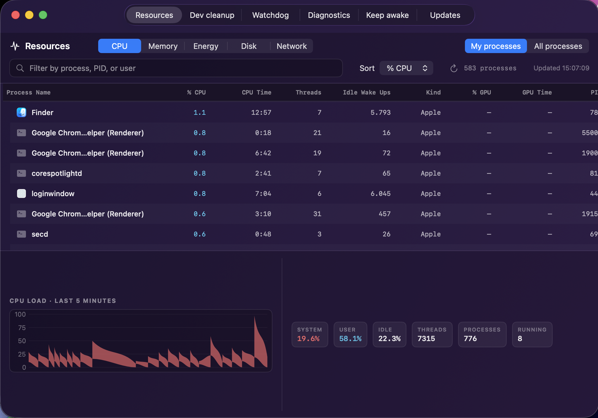

# KillSwitch

A native macOS resource manager and menu-bar utility for monitoring processes,
reclaiming disk space, and managing long-running developer workloads. Use the
SwiftUI app for live monitoring and cleanup, or the optional `killswitchctl` CLI
for headless developer-tool integrations, including AI-assisted development.



## Features

- **Live resource monitoring:** CPU, memory, energy, disk, and network process
  views with five-minute graphs, system summaries, filtering, and kill controls.
- **Guided disk cleanup:** inspect large files, temporary data, caches, and large
  folders before moving selected items to Trash.
- **Developer cleanup and alerts:** configurable dev-server cleanup, CPU watchdog
  notifications, and JSON CLI commands for syncing integration ports.
- **Screen time and keep-awake controls:** local active-time tracking, optional
  break reminders, and timed or indefinite sleep prevention.
- **Native diagnostics and updates:** spindump/sysdiagnose collection, menu-bar
  access, and opt-in automatic updates for app and standalone installations.

[Install](#install) | [Usage](#usage) | [CLI](#headless-cli-and-porto-integration) |
[Development](#development) | [Documentation](#documentation)

## Requirements

- **macOS 13+ (Ventura or later)** on Apple Silicon or Intel. The release DMG
  includes a universal app; Windows and Linux are not supported.
- **No developer tools are needed for prebuilt releases.** Building from source
  requires Git, Swift 5.9+, and Xcode Command Line Tools or Xcode.
- **Administrator authorization** is required for spindump and sysdiagnose.
  Ordinary monitoring runs as your user; installation needs a writable folder.
- Disk scans may require **Full Disk Access** for protected folders. macOS can
  still restrict individual process metrics.

## Install

### macOS app (recommended)

1. Download [KillSwitch.dmg](https://github.com/mbianchidev/kill-switch/releases/latest/download/KillSwitch.dmg)
   from the [latest release](https://github.com/mbianchidev/kill-switch/releases/latest).
2. Open the DMG and drag **KillSwitch.app** onto the **Applications** shortcut.
3. Eject the DMG, then open **KillSwitch** from `/Applications`.

The app is ad-hoc signed, but **not Developer ID signed or notarized by Apple**.
If macOS blocks it, quit KillSwitch and run this exact command in Terminal after
copying it to Applications:

```bash
xattr -dr com.apple.quarantine /Applications/KillSwitch.app
```

Then open KillSwitch again. Only remove quarantine from a download you trust.
This removes the downloaded-file quarantine attribute for this app only; it does
not sign or notarize it, or disable Gatekeeper system-wide. The release includes
[KillSwitch.dmg.sha256](https://github.com/mbianchidev/kill-switch/releases/latest/download/KillSwitch.dmg.sha256)
if you want to verify the download's SHA-256.

Automatic updates require the app and its installation folder to be writable by
your account. A normal user-owned copy in `/Applications` works; use
`~/Applications` if your account cannot update the system Applications folder.
Do not run the app directly from the read-only DMG when updating. If you install
elsewhere, adjust the quarantine command and CLI symlink to match that path.

To run at login, add **KillSwitch** in **System Settings > General > Login Items**
(**Login Items & Extensions** on newer macOS versions). App installs do not add a
login item automatically.

If you previously installed with the script, quit the old copy and run its
[uninstaller](#uninstall) before switching. Otherwise its LaunchAgent can start a
second copy. Saved preferences and synced integration ports are retained.

The DMG does not modify your shell or install the CLI automatically. See
[Headless CLI and Porto integration](#headless-cli-and-porto-integration) for the
optional symlink.

### Standalone binary and CLI

From outside a source checkout, this downloads the latest prebuilt binary,
starts the GUI immediately, and sets it up to run at login. No `sudo` or
developer tools are needed. Review the script before running it:

```bash
curl -fsSL https://raw.githubusercontent.com/mbianchidev/kill-switch/main/install.sh | bash
```

The installer verifies the binary's SHA-256, installs it to `~/bin/KillSwitch`,
creates `~/bin/killswitchctl` as a symlink to that same
binary, and loads `~/Library/LaunchAgents/io.killswitch.agent.plist`. Re-running
it upgrades an existing install and refreshes the CLI symlink. From a checkout
with Swift available, it builds locally instead; override with
`KILLSWITCH_INSTALL_MODE=source` or `KILLSWITCH_INSTALL_MODE=release`.

Ensure `~/bin` is on `PATH` before invoking `killswitchctl`.
Install, update, and uninstall refuse to replace or remove `~/bin/KillSwitch`
when it is a real directory. Existing binary files and symlinks are replaced or
removed safely. The `~/bin/killswitchctl` path is app-owned only when it is a
symlink; regular files and directories at that path are preserved.

### First run

The app opens on **Resources** with **My processes** selected. A live process
table and a KillSwitch menu-bar icon confirm it is running. Select
**All processes** to include system and other-user processes.

**Before opening Dev cleanup:** automatic termination is **enabled by default**
for qualifying dev servers older than **12 hours**. Opening that tab runs a
cleanup immediately. Age means total process lifetime, not inactivity; read
[Safety and limitations](#safety-and-limitations) before using it.

<a id="menu-bar-tray"></a>

Closing the window hides it and removes the Dock icon; it does **not** quit.
Use **Show KillSwitch** in the menu bar to reopen it, or **Quit KillSwitch** to
exit. The watchdog, screen-time tracker, and any active keep-awake session
continue while the window is hidden. Resource sampling continues if Resources
remains the selected tab. See [Menu-bar behavior](docs/development.md#ui-and-menu-bar)
for the status icon, active-duration checkmarks, and menu actions.

<a id="tabs"></a>

## Usage

### Resources

Filter by process name, PID, or user and sort by the selected resource. Application
icons and executable names are shown where macOS exposes them.

| Mode | Process data and system summaries |
| --- | --- |
| CPU | CPU usage/time, threads, idle wakeups, architecture, PID, user, and stacked user/system CPU graph |
| Memory | Physical footprint, threads, open files, PID, user, pressure, physical/app/cached/wired/compressed memory, and swap |
| Energy | Current impact, rolling power history, sleep prevention, battery charge, and power source |
| Disk | Process bytes read/written, free/occupied capacity, system operation totals, and live throughput |
| Network | Process bytes/packets sent and received, system totals, and live throughput |

CPU, memory, disk, and network sample every **6 seconds**; Energy samples every
**15 seconds** because its collector is heavier. Heavyweight collectors run only
for the selected metric, and leaving the Resources tab stops sampling.
Protected-process fields, GPU counters, and App Nap data may be unavailable
and display a dash rather than fabricated values.

### Disk cleanup

- Opens on **Largest files**, sorted by occupied disk space. Switch to
  **Temporary**, **Caches**, or **Large folders** as needed.
- Browse with breadcrumbs, filter by name or path, reveal items in Finder, and
  select cleanup candidates. Scans continue across tab/folder changes; completed
  locations are cached, and **Rescan** updates rows without clearing them first.
- Every removal requires confirmation and moves items to the macOS Trash.
  KillSwitch does not permanently delete them.
- Standard home folders such as Documents, Downloads, Pictures, and Movies
  must be opened before selecting their contents. Home Library/configuration
  locations and cleanup roots are protected; iCloud-synced items are excluded
  to avoid deleting data from other devices.
- Partial scans report permission problems and link to **Full Disk Access**.
  Updating an ad-hoc-signed app or standalone binary may require granting access
  again.

### Dev cleanup

Lists PID, command, and port for watched listeners and recognized dev servers.
Default watched ports are 3000-3003, 4000, 4200, 5000/5001, 5173/5174, 5555,
6006, 8000/8001, 8080/8081, 8090, 8443, 8888, and 9000/9090/9091.

Automatic cleanup considers processes owned by the current user that match
both a configured runtime and dev-server command signature. Default exclusions
protect Copilot, MCP servers, IDEs, language servers, and other listed apps;
commands under `/System/` are skipped. Porto-managed Lima hostagents are protected
independently of editable exclusions.

See [Developer cleanup defaults](docs/development.md#developer-cleanup-defaults)
for the runtime families and named protection examples.

The **Settings** card persists these controls across launches:

| Setting | Default / choices |
| --- | --- |
| Auto-kill | Enabled; can be disabled without removing manual kill buttons |
| Kill-after age | 12 hours; choose 1, 6, 12, 24, 48, or 72 hours |
| Port refresh | Every 5 seconds; choose 5/10/30 seconds or 1 minute |
| Cleanup pass | Every 10 minutes; configurable interval |
| Detection | Editable ports, runtimes, dev-server indicators, and protected substrings |

**Run cleanup now** uses the saved auto-kill and age settings and shows candidate
and termination counts. **Reset to defaults** re-enables auto-kill, restores all
values, clears synced integration ports, and immediately runs cleanup.

### CPU watchdog

The **Watchdog** tab watches parent-collapsed process CPU and sends native
notifications after consecutive high-CPU observations. Defaults are **90% CPU**,
**3 checks**, and a **5-minute** interval. Threshold (80/85/90/95%), interval, and
check count are configurable for the current app session.

The per-process counter resets after each alert. Current offenders have kill
buttons, recent alerts appear in the app, and
`~/Library/Logs/cpu-watchdog.log` retains the last 500 lines.

### Screen time

Tracks today's active use and the current continuous stretch. Counting pauses
after **5 minutes** without keyboard/pointer input; **10 minutes** idle, screen
lock, display/system sleep, or a long monitoring gap ends the stretch.

Optional **Touch grass** reminders are off by default, with a **2-hour** interval
when enabled (configurable from **1 to 12 active hours**). Changing the interval
schedules the next future boundary, not an immediate overdue reminder.

Today's total, current stretch, settings, and last reminder persist across
launches. Daily totals reset at local midnight without ending an active stretch.
Only aggregate durations are stored locally, not app, website, keystroke, or
pointer histories.

### Diagnostics

**Generate Spindump** samples user/kernel stacks for 10 seconds, previews the
report, and offers Save/Reveal. **Run System Diagnostics** creates a full
`sysdiagnose` archive; use the tab, menu bar, or **Shift-Command-D** while the
app is active. macOS also provides **Control-Option-Shift-Command-Period**.

Both actions request administrator authorization and write to
`~/Downloads/KillSwitch Diagnostics/`. Collection may take several minutes.
Review diagnostic reports for sensitive data before sharing them. See
[Resources and system diagnostics](docs/system-diagnostics.md).

### Keep awake

Start or stop a session from the tab or **Keep Mac Awake** menu. Choose
indefinitely, 5/10/15/30 minutes, or 1/2/5 hours; select **Deactivate** to restore
normal sleep behavior.

Settings persist the default duration, whether the display may sleep, and
optional activation at launch. Defaults are indefinite duration, keeping the
display on, and **no activation at launch**. An active session prevents idle
system sleep; it is not a guarantee against lid-close or forced sleep.

### Safety and limitations

- **Cleanup is age-based, not idle detection.** A busy dev server can qualify.
  Watched ports control discovery/listing, not which processes automatic cleanup
  may terminate; matching servers on other ports can qualify too.
- **Manual kill buttons are separate from auto-kill settings.** Disabling
  auto-kill or adding an exclusion does not disable those buttons. Termination
  sends SIGTERM, with SIGKILL as a fallback if sending SIGTERM fails, and can
  lose unsaved work. Uninspectable processes and Porto hostagents are refused.
- macOS permissions still apply to process access, disk scans, and diagnostics.
  **All processes** does not grant administrator privileges.
- Releases are ad-hoc signed, not Apple-notarized. SHA-256 verification checks
  integrity against the published checksum, not an Apple-verified publisher
  identity. Keep-awake sessions and monitoring stop when the app quits.

## Headless CLI and Porto integration

The standalone installer creates `~/bin/killswitchctl`. For an app installation,
create the optional symlink yourself:

```bash
mkdir -p "$HOME/bin"
ln -s /Applications/KillSwitch.app/Contents/MacOS/KillSwitch "$HOME/bin/killswitchctl"
export PATH="$HOME/bin:$PATH"
```

Adjust the app path for a custom location. `ln -s` deliberately refuses to
overwrite an existing alias; remove the old script installation first. Add
`~/bin` to your shell configuration to keep it on `PATH`.

The executable basename selects headless mode before SwiftUI starts: CLI calls
never open the window or menu-bar item. Running the binary as `KillSwitch`
starts the GUI instead. Verify the CLI without terminating processes:

```bash
killswitchctl dev-cleanup status --json
```

It returns the version, saved auto-kill mode, user ports, integration ports, and
merged effective ports. For example, with a customized single user port:

```json
{
  "autoKillEnabled": true,
  "effectivePorts": [3000, 41000, 41001],
  "integrationPorts": {
    "porto": [41000, 41001]
  },
  "userPorts": [3000],
  "version": "v1.2.3"
}
```

`autoKillEnabled` is the saved KillSwitch Dev cleanup mode, so integrations can
show whether a subsequent cleanup call is allowed to terminate candidates.

To persist or clear an integration's watched ports:

```bash
killswitchctl dev-cleanup sync-ports --source porto --ports 41000,41001 --json
killswitchctl dev-cleanup sync-ports --source porto --ports='' --json
```

`sync-ports` returns the same response shape as `status`. Each source is stored
separately; an empty value (`--ports=''` or `--ports=`) clears it. User-edited
ports are never overwritten, and the running app merges the latest persisted
integration ports without restarting.

**The following command can terminate processes.** It uses the same service as
**Run cleanup now**, including saved auto-kill, age, runtime, dev-indicator, and
exclusion settings:

```bash
killswitchctl dev-cleanup cleanup --json
```

Example response (values are illustrative, not current process data):

```json
{
  "autoKillEnabled": true,
  "candidateCount": 2,
  "killedCount": 1,
  "killedProcesses": [
    {
      "ageHours": 13.5,
      "command": "/usr/local/bin/node vite --port 41000",
      "pid": 12345,
      "runtime": "node"
    }
  ],
  "version": "v1.2.3"
}
```

Invalid arguments exit `2`; runtime or persistence failures exit `1`. Errors are
JSON on stderr:

```json
{"error":{"code":"invalid_arguments","message":"..."}}
```

Porto is optional, not a prerequisite. An integration can detect `killswitchctl`,
sync managed ports under its own source name, and invoke cleanup. If auto-kill is
disabled, or a candidate has not crossed the saved age threshold, it is not
terminated. Processes that fail the saved runtime, indicator, ownership, system,
or exclusion checks are not candidates. Porto-managed `limactl hostagent` processes are hard-protected
across every KillSwitch termination path, independent of editable exclusions.

## Uninstall

**App installation:** choose **Quit KillSwitch** in the menu bar, remove its
login item in System Settings if you added one, then move
`/Applications/KillSwitch.app` to Trash. The Updates tab's **Show in Finder**
button reveals your app. Remove the `~/bin/killswitchctl` symlink too if you
created it. Preferences are retained.

**Standalone/script installation:** open the **Updates** tab and click
**Uninstall KillSwitch** (removes
the binary, `killswitchctl` symlink, and login LaunchAgent, then quits). Or from a terminal:

```bash
curl -fsSL https://raw.githubusercontent.com/mbianchidev/kill-switch/main/uninstall.sh | bash
# or, from a checkout:
./uninstall.sh
```

<a id="updates"></a>

## Updating

The **Updates** tab shows the installed/latest versions, release notes, and
**Check for updates**. Checks run at launch and every **hour** by default;
choose an interval from **15 minutes to 24 hours**. Automatic installation is
**off by default**: enable **Update automatically** or use **Download & install**.

**App installation:** the updater verifies the DMG's SHA-256 and the app's
identity, version, native architecture, and signature. A bundled helper stages
and replaces the whole app, confirms startup, and rolls back failed relaunches.
The existing CLI symlink and login-item path stay valid. The app and its parent
folder must be writable; updating from the read-only DMG is not supported.
No `sudo` or developer tools are needed.

A failed version pauses automatic installation to prevent restart loops; the
tab shows the error and offers manual retry. Details are logged to
`~/Library/Logs/killswitch-update.log`. See [Auto-update](docs/auto-update.md)
for validation, startup confirmation, rollback, and release details.

Manual replacement with the [latest DMG](https://github.com/mbianchidev/kill-switch/releases/latest/download/KillSwitch.dmg)
also remains available. Quit the app before replacing it, and repeat the `xattr`
command above if macOS blocks that manually downloaded copy. Verified automatic
updates clear quarantine on the staged bundle without altering its signature.

**Standalone/script installation:** open the **Updates** tab (or wait for the
launch check) and click **Download & install** when a newer version is offered.
The updater overwrites whatever binary the LaunchAgent launches and refreshes the
`~/bin/killswitchctl` symlink, so the GUI and CLI always use the same release.

The release workflow publishes auto-incremented semver releases from pushes to
`main`, including the universal DMG and standalone binary assets.

<a id="tech-stack"></a>

## Development

KillSwitch uses Swift, SwiftUI, Swift Charts, AppKit, and native macOS
process/power APIs. Shared SwiftPM targets isolate dev cleanup, disk cleanup,
installation/update safety, keep-awake control, screen time, and system-metric
logic. There are no third-party Swift package dependencies.

The [development and implementation reference](docs/development.md) preserves
the full tech stack, native integrations, cleanup defaults, and alternative
source-installation commands.

<a id="run-without-installing"></a>

### Build and run without installing

On macOS with the [source prerequisites](#requirements):

```bash
git clone https://github.com/mbianchidev/kill-switch.git
cd kill-switch
swift build -c release --product KillSwitch
.build/release/KillSwitch
```

This starts the GUI without creating a login item. Local builds report `dev`;
any published release is considered newer by the updater. Headless calls still
require a `killswitchctl` symlink; passing CLI arguments directly to a binary
named `KillSwitch` does not select CLI mode.

<a id="build-the-standalone-installation-from-source"></a>

To install the standalone build from the checkout, run
`KILLSWITCH_INSTALL_MODE=source bash install.sh`. To update that installation,
run `bash update.sh` from the checkout; it pulls/rebases the current branch,
builds, replaces the binary, and reloads the LaunchAgent. See
[Source installation](docs/development.md#standalone-source-installation) for
the executable-script alternative and installation steps.

<a id="build-the-app-and-dmg-from-source"></a>

### Build and verify the app and DMG

```bash
bash scripts/package-macos.sh
bash scripts/check-macos-package.sh
```

Packaging builds Apple Silicon and Intel executables, creates and ad-hoc signs
`KillSwitch.app` and its update helper, and writes **`dist/KillSwitch.dmg`** with
an Applications shortcut. It also writes the standalone binary, tarball, and
SHA-256 files used by the script installer. The release workflow embeds the
published version; local bundles default to `dev` (`0.0.0`).

The package check mounts the DMG read-only without opening Finder, verifies
bundle metadata, signatures, architectures, checksums, and headless CLI dispatch,
then ejects it. It exercises a copied app and the update helper without launching
the GUI, installing a login item, or running process cleanup.

### Run checks

The test targets are executable checks, not an XCTest suite. Run the same checks
as [CI](.github/workflows/ci.yml):

```bash
swift run DevCleanupCoreChecks
swift run DiskCleanupCoreChecks
swift run InstallCoreChecks
swift run SystemMetricsChecks
swift run ScreenTimeCoreChecks
```

Install checks use signed mock bundles to exercise path safety, whole-app
replacement, rollback, quarantine handling, permissions, and restart-loop
prevention.

If preview Command Line Tools report a missing `SwiftUIMacros` plugin, select a
compatible **installed** SDK before rerunning the build/check commands, without
changing the global toolchain. For example, with the macOS 26.5 SDK installed:

```bash
export SDKROOT="$(xcrun --sdk macosx26.5 --show-sdk-path)"
```

## Documentation

- [Development and implementation](docs/development.md): full tech stack,
  native integrations, developer-cleanup defaults, menu behavior, and source
  installation alternatives.
- [Resources and system diagnostics](docs/system-diagnostics.md): metric sources,
  permissions, and report collection.
- [Auto-update](docs/auto-update.md): release versioning, packaging, verification,
  and update recovery.
- [CI and security scanning](docs/ci-security.md): CodeQL configuration and
  build-cache constraints.
- [Releases](https://github.com/mbianchidev/kill-switch/releases): published DMGs,
  standalone binaries, and checksums.

## Contributing

[Bug reports](https://github.com/mbianchidev/kill-switch/issues) and pull requests
are welcome. Include your macOS version, CPU architecture, and reproduction
steps. For code changes, run the core checks and package verification above.
Use mock data in tests and review logs or diagnostic reports before sharing.

## License

KillSwitch is available under the [MIT License](LICENSE).
